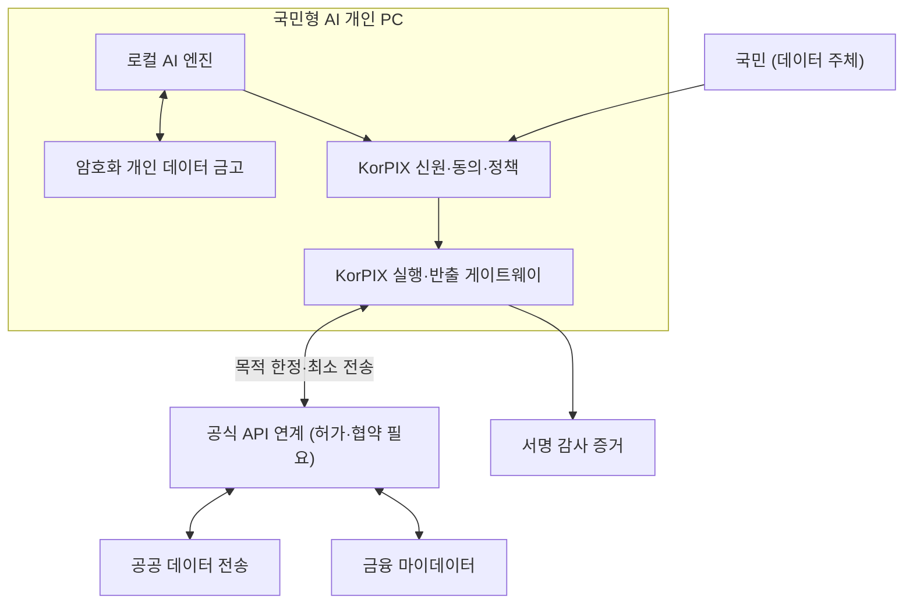

# KorPIX Sovereign Personal AI PC Architecture

**문서 상태:** 비전 및 목표 아키텍처 v0.1 · 2026-10-23  
**핵심 대상:** 국민형 AI 개인 PC, 국내 공공·금융 데이터의 적법한 상호운용, 개인/국가 데이터 주권  
**구현 상태:** 현재 KorPIX Core는 Policy / Mock Execution / In-memory Audit 프로토타입입니다. 아래는 향후 목표이며 정부 채택·기관 연계·상용 보안 인증을 의미하지 않습니다.

## 1. 왜 필요한가

국민이 AI를 사용하는 과정에서 문서·대화·업무·금융 정보가 불필요하게 외부 서비스로 전송되거나, AI가 사용자의 명시적 권한 없이 현실의 행동을 수행하는 상황을 줄여야 합니다. KorPIX는 **국민 개인의 데이터 통제권을 우선**하면서 국내 기술·인프라의 선택권과 국가의 전략적 자율성을 강화하는 공통 신뢰 아키텍처를 제안합니다.

**비전:** 국민의 데이터는 국민의 통제 아래, AI의 행동은 허가된 범위 안에서, 중요 실행은 검증 가능한 증거와 책임을 남깁니다.

**하지 않는 일:**
- 모든 국민의 원본 개인정보를 국가 단일 데이터베이스에 수집하지 않습니다.
- '국내 서버'라는 이유만으로 정보 유출이 불가능하다고 주장하지 않습니다.
- 법적 근거·동의·자격 없이 정부/금융 데이터를 자동 취득하지 않습니다.
- 개인 데이터를 별도 법적 근거 없이 국가 AI 모델 학습에 사용하지 않습니다.

## 2. 세 가지 주권의 균형

| 주권 | 구체적 의미 | 주요 설계 수단 |
|---|---|---|
| 국민의 데이터 주권 | 데이터 열람·이용·전송·동의·철회를 국민이 통제 | Personal Data Vault, Consent Receipt, 목적 제한 |
| 기술·실행 주권 | 모델/클라우드를 교체해도 행동 통제와 기록을 유지 | Model-agnostic API, KorPIX Policy + Action Gateway |
| 국가 데이터 인프라 주권 | 국내 공공/금융/산업 인프라를 안전하게 연계 | 표준 API, 적법한 기관 연계, 독립 검증·감사 |

'국가 데이터 주권'은 **국가의 포괄적 개인 데이터 접근권**을 뜻하지 않습니다.

## 3. 목표 계층

1. **Hardware Trust (AI PC / Trust Terminal):** 키 보호, 측정 부팅, 단말 신원, 향후 TPM/TEE 하드웨어 구현.
2. **Local Intelligence & Personal Data Vault:** 로컬 AI 추론 우선, 암호화된 개인 데이터 저장, 사용자별 키/백업/삭제·복구.
3. **KorPIX Identity, Delegation & Policy:** 사용자·기기·에이전트 인증, 역할/위임, 위험·목적·승인·철회 정책.
4. **KorPIX Execution & Data Egress:** 검증된 행동만 실행, 데이터 필드·수신자·국가·보존기간에 따른 전송 통제.
5. **Sovereign Connector:** 공공 마이데이터/금융 마이데이터의 공식 API와 적격 기관 협력, 스키마 매핑과 오류 처리.
6. **Evidence & Audit:** 목적·동의·정책 버전·승인자·실행 결과의 최소 메타데이터에 대한 영구 서명 증거.

## 4. 신뢰 경계 및 데이터 흐름

- **기본값:** 개인 원본 데이터는 단말 또는 기존 적법한 원천기관에 남기며, 필요 최소한의 데이터만 이동합니다.
- **클라우드 AI:** 민감 데이터를 그대로 외부 모델에 보내지 않습니다. 로컬 모델이 부족할 경우에도 국내 추론 서비스를 우선 검토하고, 전송 허용 여부를 별도 정책·법적 근거에 따라 판단합니다.
- **공익 분석:** 필요하다면 별도 동의/법적 근거와 안전성 평가를 거친 통계·집계만 사용합니다. 연합학습이나 차등 개인정보보호도 적합성/재식별 위험 검증 후 선택할 수 있습니다.
- **국외 이전:** 허용/제한은 관련 법령 요건에 따라 판단하며, 반출 경로와 수신자·보관 위치를 투명하게 보여줍니다.

## 5. 제안하는 표준 인터페이스

| 메시지 | 필수 목적(초안) |
|---|---|
| `ActionRequest` | 에이전트/기기, 행동 유형, 목적, 대상, 데이터 종류·해시 |
| `ConsentReceipt` | 정보주체, 허용 범위·목적·수신자·만료·철회 식별자 |
| `PolicyDecision` | 허용/확인/관리자 승인/차단, 정책 버전, 이유, 위험도 |
| `EgressPermit` | 허가된 행동/데이터의 해시·수신자·기한·1회성 값·서명 |
| `ExecutionResult` | 실행 ID·결과·오류·중지/복구 상태 |
| `EvidenceRecord` | 승인·반출·실행의 타임스탬프·무결성 증거·연계 ID |

`EgressPermit`는 서명 검증과 재전송 방지가 가능한 별도 정책 증명이어야 합니다. 단순 LLM 프롬프트의 '허용' 응답만으로 실행하면 안 됩니다.

## 6. 법·기관 연계의 경계

- **공공:** 개인정보 전송요구권과 기관별 공식 API 또는 사전협의된 안전한 방법을 검토합니다. 전송 요구의 행사 주체·대리인 자격·전송 대상 범위를 확인해야 합니다.
- **금융:** 금융 마이데이터의 법정 요건과 보안 점검·표준 API, 적격 사업자/기관과의 계약을 전제로 합니다.
- **국외 이전:** 개인정보 보호법 제28조의8 등 적용 조항에 따라 동의·계약 등 허용 근거와 추가 보호조치를 검토합니다.
- **정보주체 권리:** 이용 목적·허용 범위·철회·열람·삭제, 안전한 위임 및 분쟁 처리 절차를 설계합니다.

법률 적합성은 서비스·데이터·기관·시점별 법무/규제 검토가 필요합니다.

## 7. 최소 실증(MVP)과 통과 조건

**첫 실증:** 국민 1명이 자신의 AI PC에 문서를 보관하고, 로컬 AI가 요약하고, 외부 데이터가 필요한 경우 목적과 필드를 선택하여 승인한 뒤, 모의 기관 API로 제한된 데이터만 전송하는 과정.

- [ ] 로컬 전용 작업에서 외부로 개인 원문이 나가지 않는지 네트워크 감시로 확인
- [ ] 동의/정책 없이 전송하면 모든 테스트에서 실행 차단
- [ ] 승인 토큰 위조·만료·재사용 시 게이트웨이가 차단
- [ ] 누가 왜 무엇을 보냈는지 최소 메타데이터와 서명 증거로 검증
- [ ] 사용자가 철회한 뒤 신규 접근이 중단되는지 확인
- [ ] PC 재시작·오프라인·업데이트 실패 상황에서 데이터와 정책 보호
- [ ] 디지털 취약계층을 포함해 이해하기 쉬운 승인 UI 검증

**1단계 성공 기준은 전국 배포가 아니라, 한 명의 사용자가 자신의 데이터와 AI 행동을 실질적으로 통제할 수 있음을 입증하는 것입니다.**

## 8. 참고할 공식 제도 자료 (2026년 기준)

- [개인정보보호위원회 — 전 분야 마이데이터/본인전송요구권 확대](https://pipc.go.kr/np/cop/bbs/selectBoardArticle.do?bbsId=BS074&mCode=&nttId=11815)
- [개인정보보호위원회 — 공공기관 본인전송 대상 지정 및 사전협의](https://pipc.go.kr/np/cop/bbs/selectBoardArticle.do?bbsId=BS074&mCode=B030020000&nttId=12198)
- [금융위원회 — 금융 마이데이터 표준 API 체계](https://fsc.go.kr/no010101/77182)
- [국가법령정보센터 — 개인정보 보호법 제28조의8(국외 이전)](https://www.law.go.kr/LSW/lsLinkCommonInfo.do?chrClsCd=010202&lsJoLnkSeq=1029334953)

관련 문서: [README](../README.md) · [로드맵](../ROADMAP.md) · [보안 모델](security_model.md)
