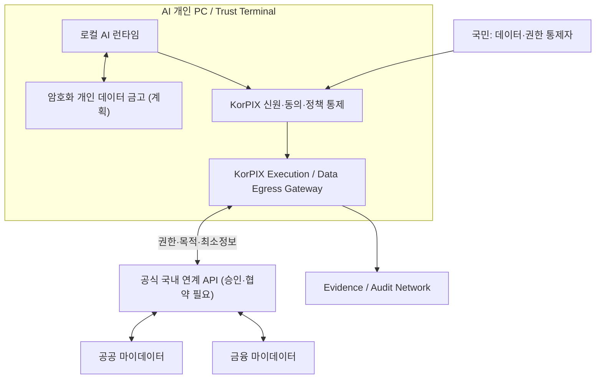

# KorPIX 시스템 아키텍처

> **현재 코드와 목표 설계를 구분합니다.** 이 저장소의 Policy/Audit/Execution 서비스는 프로토타입이며, 소버린 AI PC 계층은 설계 단계입니다.

## 1. 목표: 국민형 소버린 AI 개인 PC

- **데이터 경계:** 원본 개인 데이터는 기본적으로 단말/원천기관에 남습니다. 중앙에 국민 데이터 전체를 수집하지 않습니다.
- **AI 경계:** 로컬 추론 우선; 외부 LLM 요청은 전송 항목·수신자·지역을 검사하고 필요한 동의와 정책에 따라 결정합니다.
- **실행 경계:** LLM 출력은 실행 권한이 아닙니다. 독립 정책 승인과 유효한 실행 허가가 있어야 외부 행위를 수행할 수 있어야 합니다.
- **기관 경계:** 금융·공공 데이터는 일반 공개 API가 아니며, 적격 기관/협력 체계와 법적 절차를 통해 연계합니다.
- **증거 경계:** 승인·전송·실행의 필요 최소한 메타데이터만 기록하며, 원문·계좌·비밀번호 등 불필요한 민감정보 저장을 피합니다.

## 2. 현재 저장소의 실행 가능한 범위

| 서비스 | 기본 포트 | 현재 범위 | 아직 없는 통제 |
|---|---|---|---|
| Policy Engine | 8001 | Risk Score, 승인 결정, 일부 승인 체인, 투자 차단 | 실 사용자 IAM/위임/승인 체인 검증 |
| Execution Gateway | 8003 | Python API, 결제·투자·구매·행정 Mock | 서명된 정책 허가 검증, 실기관 API |
| Audit Network | 8002 | 해시/체인 확인, 이상 탐지 | 영구 원장, 운영용 서명·독립 검증 |

현재 서비스 호출 모델: `Agent ActionRequest → POST /evaluate → (애플리케이션이 결정을 확인) → POST /execute → POST /submit`.

**보안상의 차이:** 현재 `/execute` 자체는 정책 승인 결과를 재검증하지 않습니다. 아래 목표 모델을 실제 운영에 사용하려면 이 문제를 우선 해결해야 합니다.

## 3. 목표 행동·데이터 전송 계약

1. 사용자와 기기/에이전트 신원을 강하게 인증합니다.
2. AI가 목적·데이터 유형·필요 범위·수신자·실행 계획을 구조화합니다.
3. Policy Engine이 신원·위임·위험·목적 제한·동의를 검사합니다.
4. 고위험 작업과 외부 전송은 인간에게 의미 있는 설명을 보여 주고 승인받습니다.
5. 정책 엔진이 **행동 해시·범위·만료·1회성 ID가 결합된 서명된 허가증**을 발급합니다.
6. 실행/반출 게이트웨이가 허가증을 독립 검증하고, 허가된 작업만 수행합니다.
7. 실행 결과·동의·철회·위험 결정의 검증 가능한 증거를 남기고, 실패 시 중지·복구합니다.

이 계약은 **목표 설계**입니다. 현재 코드의 구현 수준과 동일하게 간주하지 않습니다.

## 4. 표준·연계 확장

- `ActionRequest`, `PolicyDecision`, `ConsentReceipt`, `EgressPermit`, `ExecutionResult`, `EvidenceRecord`의 스키마를 독립 버전화합니다.
- 개인 PC 제조사, 국내 모델 제공자, 공공기관, 적격 금융 사업자가 **공통 인터페이스**를 구현하도록 합니다.
- 모델 개선이나 공익 연구용 분석에는 원본 데이터를 일괄 전송하지 않고, 별도 동의·법적 근거·재식별 위험 평가 및 집계 안전성을 먼저 검증합니다.

자세한 범위와 검증 과제: [국민형 소버린 AI PC 아키텍처](sovereign_ai_pc_architecture.md), [보안 모델](security_model.md)
